<!-- Header art is generated by scripts/generate_readme_art.py. Edit that script, not the SVGs. -->
<p align="center">
  <picture>
    <source media="(prefers-color-scheme: dark)" srcset="assets/readme/header-dark.svg">
    
  </picture>
</p>

<p align="center">
  
  
  
  
  
</p>

<p align="center">
  <a href="#why-we-built-this">Why</a> ·
  <a href="#features">Features</a> ·
  <a href="#how-it-works">How it works</a> ·
  <a href="#get-started">Get started</a> ·
  <a href="#what-turns-lockin-red">What turns it red</a> ·
  <a href="#what-lockin-collects-and-what-it-doesnt">Privacy</a> ·
  <a href="#limits-honestly">Limits</a> ·
  <a href="#troubleshooting">Troubleshooting</a> ·
  <a href="#development">Development</a>
</p>

LockIn is a minimalist exam lockdown for tests given in **Google Forms**.
It is a Chrome extension (also works in Edge and Brave) plus a small desktop
companion. While a student is "locked in", LockIn flags tab switches, AI sites
like ChatGPT, and apps like Word, Notes and PDF readers. Every attempt is
blocked when possible, logged with a time, shown on screen, and can be sent
live to the professor's Google Sheet.

## Why we built this

Many classes run quizzes and exams in Google Forms because it is free and
everyone already has it. But a Form has no idea what else is open: ChatGPT is
one tab away, notes are one app away, and the professor cannot see any of it.

Full lockdown browsers fix that, but they are heavy. They need their own
install and accounts, often cost money, and many record the camera, the
microphone or the screen. That is a lot to ask of a student for a 20-minute
quiz.

LockIn sits in between:

- **Keep the tools people already use.** The exam stays a normal Google Form.
  The dashboard is a normal Google Sheet. No server, no account, no build step.
- **Make cheating visible, not impossible.** Anyone with admin rights can turn
  off any software. So LockIn does not pretend to be unbreakable. It blocks
  what it can, records every attempt with a time, and tells the professor
  when it goes quiet.
- **Respect the student.** No camera, no screenshots, no keystrokes. When
  LockIn is off it does nothing at all, and the student can always see which
  state it is in.

## Features

<table>
  <tr>
    <td width="33%" valign="top">
      <h3>Three honest colors</h3>
      Gray when off, green when locked in, red once anything is flagged. The
      toolbar icon, popup and a pill on the Form all show the same state.
    </td>
    <td width="33%" valign="top">
      <h3>Blocks AI and look-up sites</h3>
      ChatGPT, Gemini, Claude, Copilot, search engines, Brainly, Quizlet,
      Chegg, Docs, Drive, chat and social sites get a "Blocked during your
      exam" page instead.
    </td>
    <td width="33%" valign="top">
      <h3>Sees other apps</h3>
      The desktop companion reports Word, Notes, PDF readers, the ChatGPT app
      and other browsers, plus how long the student was away.
    </td>
  </tr>
  <tr>
    <td valign="top">
      <h3>Live professor dashboard</h3>
      One row per event and one live status row per student in a Google
      Sheet: ARMED, TRIGGERED, OFFLINE, UNINSTALLED, SUBMITTED.
    </td>
    <td valign="top">
      <h3>One exam code</h3>
      The professor picks the Form, allowed sites and rules, then shares a
      single code. Students paste it in and lock in.
    </td>
    <td valign="top">
      <h3>PIN-protected end</h3>
      Only the professor's PIN can end an exam early or clear a warning.
      Submitting the Form ends it by itself.
    </td>
  </tr>
</table>

### The three colors

| Color | State | Meaning |
|---|---|---|
| Gray | Off | Exam mode is not running. LockIn does nothing. |
| Green | Locked in | The exam is running and nothing has been flagged. |
| Red | Triggered | At least one violation was recorded. |

After the form is submitted, LockIn turns gray with a check mark.

## How it works

<p align="center">
  <picture>
    <source media="(prefers-color-scheme: dark)" srcset="assets/readme/flow-dark.svg">
    
  </picture>
</p>

- The **extension** is the main app. It holds the on/off switch, checks every
  page the student opens, and shows the status.
- The **desktop companion** is a small Python program. Chrome starts it only
  while LockIn is checking or locked in, and it stops when the exam ends. It
  tells the extension which app is in front (for example Microsoft Word) and
  when a watched app is opened.
- The **professor dashboard** is a Google Sheet with a short Apps Script. It
  gets one row per event and one live status row per student.

## Get started

Pick your role. Each one takes a few minutes.

<details open>
<summary><b>For professors: set up an exam</b></summary>

1. **Set up the live dashboard (optional, about 5 minutes).**
   1. Create a new Google Sheet.
   2. Open **Extensions → Apps Script**, delete the sample code, and paste in
      `apps-script/Code.gs`.
   3. Optional: type a shared secret into `SHARED_SECRET` at the top.
   4. Choose the `setup` function and click **Run** once. Allow the
      permissions it asks for.
   5. Click **Deploy → New deployment → Web app**. Set *Execute as* to
      **Me** and *Who has access* to **Anyone**. Click Deploy.
   6. Copy the URL that ends in `/exec`.
   7. In the Sheet, open **File → Settings → Calculation** and set
      *Recalculation* to **On change and every minute**, so the Online column
      stays fresh.
2. **Open Professor setup.** Install the extension (see "For students"), click
   the LockIn icon, then **Professor setup**.
3. **Fill in the form:** exam name, Google Form link, any extra allowed sites
   (for example `desmos.com`), a professor PIN (at least 4 digits), and the
   `/exec` URL and secret if you set up the dashboard. Pick the rules you want.
4. Click **Generate exam code**, then **Copy**.
5. **Share the exam code and the Form link** with your students. Keep the PIN
   to yourself.
6. **Watch the "Live Status" sheet** during the exam. Green ARMED means fine,
   red TRIGGERED means a violation, and red OFFLINE means the student's
   LockIn has not checked in for 3 minutes.
7. **Use your PIN** on a student's computer to **Clear warning** (red back to
   green, the history is kept) or to **End exam** early.

Tip: in Google Forms settings, turn on **Collect email addresses** or require
sign-in. Then Google saves the student's progress if their browser restarts.

</details>

<details>
<summary><b>For students: install and lock in</b></summary>

1. **Install the extension.**
   1. Download or clone this repository.
   2. Open `chrome://extensions` (or `edge://extensions`, `brave://extensions`).
   3. Turn on **Developer mode** (top right).
   4. Click **Load unpacked** and choose the `extension` folder.
2. **Install the desktop companion** (your professor will tell you if it is
   required). Open a terminal in the repository folder and run:
   - macOS:
     ```
     bash companion/install_macos.sh
     ```
   - Windows (PowerShell):
     ```
     powershell -ExecutionPolicy Bypass -File companion\install_windows.ps1
     ```
   Restart your browser after installing.
3. **Open LockIn** from the toolbar. Paste the exam code from your professor
   and fill in your full name, student number and section.
4. Click **Check and lock in.** If LockIn asks you to close some apps first
   (for example "Microsoft Word, Notes"), close them and click
   **Check again**. Then click **Lock in**.
5. **Answer the exam** in the window LockIn opens. Stay in that window.
6. **Click Submit** on the form. LockIn notices the submission, turns gray
   with a check mark, and you click **Done**.

</details>

## What turns LockIn red

While you are locked in, each of these is recorded with the time:

- Opening a new tab. LockIn closes it and takes you back to the exam.
- Clicking on another tab. LockIn switches you back.
- Opening a blocked website: AI tools (ChatGPT, Gemini, Claude, Copilot and
  others), search engines, homework sites (Brainly, Quizlet, Chegg),
  Google Docs, Word online, Drive, note sites, PDFs, chat and social sites.
  You see a "Blocked during your exam" page instead.
- Opening a new browser window, or switching to another browser window.
- Leaving the browser for another app for more than about 1.5 seconds, for
  example Microsoft Word, Notes, Preview or Acrobat, the ChatGPT app, or
  another browser. LockIn records which app and for how long.
- Opening a watched app (Word, Notes, PDF readers, ChatGPT, other browsers,
  chat apps, remote desktop apps), even in the background.
- Closing the exam window. LockIn opens it again.
- Opening browser settings pages such as `chrome://extensions`.
- Pasting text into the form (if the professor turned this on), or
  right-clicking (if turned on).
- The desktop companion stopping, or the browser restarting during the exam.

Leaving fullscreen is only a **warning**: it is logged and shown, but it does
not turn LockIn red.

<details>
<summary><b>Turning it on and off</b></summary>

- LockIn is **off by default.** When it is off it does nothing and watches
  nothing.
- It only turns on when you click **Lock in** with a valid exam code.
- **End exam** needs the professor's PIN. After 5 wrong tries, PIN entry is
  paused for 30 seconds.
- After you submit the form, LockIn ends by itself. Click **Done** to go back
  to gray.
- **Uninstall the extension:** open `chrome://extensions` and click
  **Remove** on LockIn. (If you remove it during an exam, the professor's
  sheet shows UNINSTALLED.)
- **Uninstall the companion:**
  - macOS: `bash companion/uninstall_macos.sh`
  - Windows: `powershell -ExecutionPolicy Bypass -File companion\uninstall_windows.ps1`

</details>

## What LockIn collects (and what it doesn't)

LockIn collects only:

- Session details you type in: name, student number, section, and the exam.
- Violation and warning events: what happened, when, the site or app name,
  and how long you were away.
- A small "still here" heartbeat once a minute while you are locked in.

These go to your professor's Google Sheet only if your professor set one up.

LockIn does **not** collect:

- Screenshots, camera, microphone or screen recordings.
- Keystrokes or anything you type into the form.
- Your browsing history. Sites are only checked while you are locked in.
- File contents or documents on your computer.
- Anything at all while LockIn is off. The desktop companion is not even
  running then.

## Limits, honestly

- **Phones and second devices.** LockIn cannot see another device on your
  desk.
- **Admin rights.** Anyone with admin rights on their own laptop can turn off
  any software, including LockIn. That is why LockIn sends a heartbeat: if it
  stops, the sheet shows **OFFLINE**, and if the extension is removed during
  an exam, the sheet shows **UNINSTALLED**. The goal is to make attempts
  visible, not impossible.
- **School-managed computers.** A school can force-install the extension with
  the Chrome `ExtensionInstallForcelist` policy so students cannot remove it.
- **Incognito windows.** The extension cannot see inside incognito windows,
  but switching to one still counts as leaving the exam window.
- The companion can only report apps it knows about (see
  `companion/watchlist.json`). Unknown apps are still caught as "Left the
  exam" when you switch to them.

## Troubleshooting

- **"Specified native messaging host not found."** The desktop companion is
  not installed, or the browser was open during install. Run the install
  command again and restart the browser.
- **"Access to the specified native messaging host is forbidden."** The
  extension ID does not match the one the companion was installed for. Check
  `extension/EXTENSION_ID.txt` and the ID shown on `chrome://extensions`. If
  they differ, run the install script again with the right ID, for example
  `bash companion/install_macos.sh <extension id>`.
- **Companion shows "Disconnected".** Run the diagnose tool to make sure it
  works on your computer:
  ```
  companion/.venv/bin/python3 companion/lockin_host.py --diagnose
  ```
  On Windows: `companion\.venv\Scripts\python.exe companion\lockin_host.py --diagnose`.
  The log is in `~/.lockin/companion.log` (macOS) or
  `%LOCALAPPDATA%\LockIn\companion.log` (Windows).
- **The Google Sheet is not receiving anything.** Open the `/exec` URL in a
  browser: it should show `{"ok":true}`. If you changed the script, deploy a
  **new version** (Deploy → Manage deployments → Edit → New version). Check
  that *Who has access* is **Anyone**, and that the shared secret matches on
  both sides.

## Development

```
extension/        Chrome extension (Manifest V3, plain ES modules, no build step)
  background.js   service worker: state, rules, violations
  lib/            constants, state, URL rules, exam code, companion, reporter, icons, tests
  popup/          toolbar popup
  options/        Professor setup page
  blocked/        "Blocked during your exam" page
  content/        status pill shown on the Google Form
  icons/          gray PNG icons (made by scripts/generate_icons.py)
companion/        Python desktop companion (native messaging host) + install scripts
apps-script/      Code.gs for the professor's Google Sheet
scripts/          generate_icons.py, generate_key.py
```

Run the tests:

```
node --test extension/lib/rules.test.mjs
python3 -m unittest discover companion/tests
```

**Stable extension ID.** `manifest.json` has a `key` field so that every
"Load unpacked" install gets the same extension ID. The desktop companion
needs that ID to allow the connection. The ID is saved in
`extension/EXTENSION_ID.txt`. `python3 scripts/generate_key.py` creates the
key (the private `.pem` stays in the git-ignored `scripts/.keys/`). If the
`.pem` is missing, the script keeps the key already in `manifest.json`, so the
ID does not change. Use `--new` only if you really want a new ID; every
student would then need to reinstall the companion.

Remake the icons with `python3 scripts/generate_icons.py`.

<details>
<summary><b>Build decisions</b></summary>

- `scripts/generate_key.py` keeps the existing manifest key when the private `.pem` is missing (for example in a fresh clone), so the extension ID cannot change by accident. `--new` forces a new key.
- The Apps Script dashboard also colors `UNINSTALLED` red, and turns any SESSION_END into `SUBMITTED` (if the reason mentions submit) or `ENDED`.
- The Apps Script escapes cell text that starts with `=`, `+`, `-` or `@` so student input cannot become a spreadsheet formula.
- The Events "Detail" column shows the event label, with the raw detail in brackets when it adds something.
- Exam code checksum is the first 8 hex chars of SHA-256 over the base64url payload string. Whitespace and line breaks pasted into the code are ignored.
- Categories the professor unticks are allowed. Browser settings pages, local files, LockIn's own setup page and unknown sites are always blocked.
- A new tab to an unknown site counts as `NEW_TAB`; a known category (e.g. ChatGPT) counts as `BLOCKED_SITE`. Allowed tabs opened from the exam tab (e.g. Google sign-in) are kept as helper tabs.
- All state changes go through one queue in the service worker, so overlapping browser events cannot overwrite each other.
- If the service worker sleeps through the grace period, `LEFT_BROWSER` is recorded when focus returns, with the time away.
- When the away time is known only after the violation was already sent to the sheet, an extra `FOCUS_RETURNED` event carries it (shown in the "Away (s)" column).
- After a precheck the companion stays connected for 120 seconds so Lock in can reuse it, then disconnects if LockIn is still off.
- `COMPANION_DISCONNECTED` is recorded once per outage. LockIn reconnects after 1s, 2s and 4s, then every minute.
- After a browser restart, restored tabs and windows are not flagged for 10 seconds.
- The heartbeat alarm keeps running after the exam ends until the last queued events are sent.
- The violation log keeps the latest 500 records and the outbox keeps 1000 events.
- The companion treats Word processors (`WORD`) as part of the `DOCS` category and never flags video-call apps.
- On macOS the companion collapses helper processes into their `.app` and treats Chrome's `*.app.bundle` copy like `*.app`.
- App display names match as whole words, so "Arc" does not match "Archive Utility".
- `hello`/`ping` still work without psutil; the precheck then reports `warning: "psutil_missing"`.
- The paste report sends only the number of characters pasted, never the text.
- The off-state primary button is dark gray (`#52525B`) because white text on `#A1A1AA` is hard to read.
- The pill builds its DOM with `createElement` (Google pages enforce Trusted Types) and also counts plain `<button>` elements when checking for Next/Submit/Back.
- Professor setup remembers its non-PIN fields in a local draft (`lockin_prof_draft`). The PIN is never stored.

</details>

The README art in `assets/readme/` is generated. Remake it with
`python3 scripts/generate_readme_art.py`.

---

<p align="center"><sub>MIT licensed · made for classrooms that run exams in Google Forms</sub></p>
